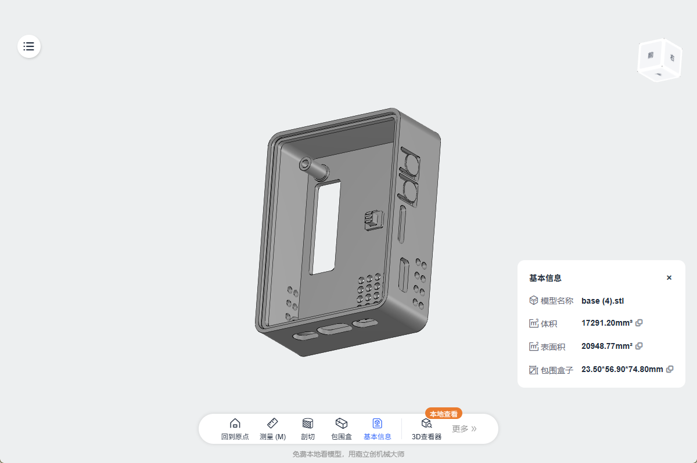

# ESP32-S3 空气质量监测仪

基于 [Waveshare ESP32-S3-Touch-LCD-2.8B](https://docs.waveshare.net/ESP32-S3-Touch-LCD-2.8B/) 的桌面空气监测仪，ESPHome 固件 + 参数化 3D 打印外壳。



## 功能

- CO2 圆环仪表，四级配色，配温湿度与时钟
- 8 小时趋势柱状图，每格 30 分钟，数据存 NVS 不丢
- 触摸设置面板：亮度、自动息屏、通风阈值、传感器基线校准
- 挥手唤醒（QMI8658）、巴法云 MQTT 上报、内置网页
- 断网自动开热点配网

## 硬件

ESP32-S3R8（16MB Flash / 8MB PSRAM）+ ST7701S 480×640 屏 + GT911 触摸 + SCD41 + QMI8658 + TCA9554。

I2C：SDA 15 / SCL 7。背光：GPIO6。

板子资料、原理图和引脚定义见[微雪官方文档](https://docs.waveshare.net/ESP32-S3-Touch-LCD-2.8B/)。

## 仓库结构

```
air-quality.yaml      ESPHome 主配置
components/st7701s/   本地覆盖的显示组件（熄屏降频等改动）
secrets.yaml.example  密钥模板
fonts/               思源黑体（界面字形来源）
enclosure/           3D 打印外壳（源码 / STEP / STL / 说明）
```

## 编译烧录

```bash
cp secrets.yaml.example secrets.yaml   # 填 WiFi 和巴法云私钥
esphome run air-quality.yaml
```

Windows 上要在 PowerShell 里跑，Git Bash 会因为 `MSYSTEM` 报 `MSys/Mingw is not supported`。

## 外壳

参数化建模，改 `enclosure/source/enclosure.py` 里的 `P` 字典即可调尺寸。

打印只需 `enclosure/stl/base.stl` 一个文件——壳体、停泊的 PWR 滑块和易折断水口是一个连通实体，嘉立创只算 1 个免费位。

重新生成：

```bash
pip install cadquery trimesh numpy
python enclosure/source/enclosure.py
python enclosure/source/validate.py
```

具体打印参数和装配顺序见 `enclosure/打印与装配说明.pdf`。
